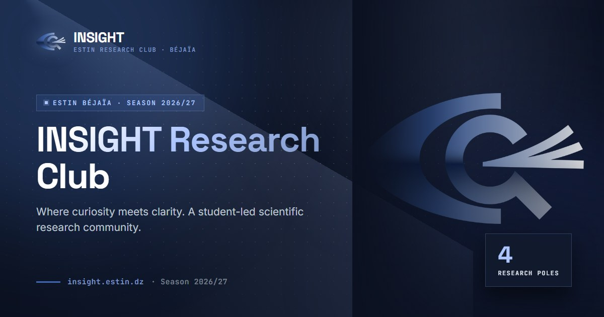
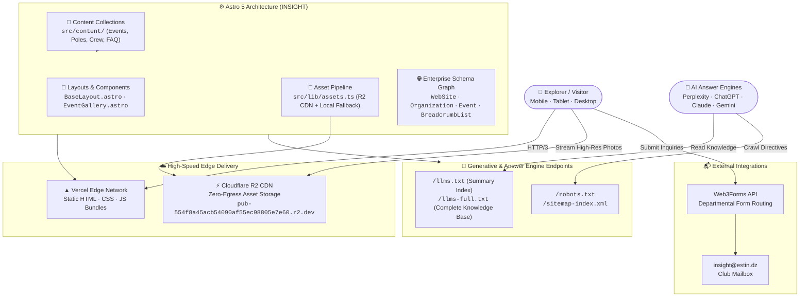

<div align="center">

<a href="https://insight.estin.dz">
  
</a>

<br>

[](https://insight.estin.dz)
[](https://astro.build)
[](https://tailwindcss.com)
[](https://developers.cloudflare.com/r2/)
[](https://vercel.com)
[](https://estin.dz)
[](https://www.instagram.com/insight.estin/)
[](https://www.linkedin.com/company/insight0)

**Four Research Poles · The Voyage from Rookie to Captain · SPARK Workshop · Pro Bento Gallery · Global Researcher Network**<br>
The official digital platform of **INSIGHT**, the student-led scientific research club of ESTIN Béjaïa. Fast, responsive, accessible, and optimized for both human explorers and modern AI answer engines.

[**Visit Website**](https://insight.estin.dz) &nbsp;·&nbsp;
[Features](#-features) &nbsp;·&nbsp;
[Architecture](#-system-architecture) &nbsp;·&nbsp;
[Visual Identity](#-visual-identity--design-tokens) &nbsp;·&nbsp;
[SEO & AEO](#-seo--answer-engine-optimization-aeo) &nbsp;·&nbsp;
[Cloudflare R2 Pipeline](#-cloudflare-r2-asset-pipeline) &nbsp;·&nbsp;
[Develop](#-local-development)

</div>

<br>

---

## ✦ Overview

**INSIGHT** is the student-led scientific research club of **ESTIN** (*École Supérieure en Sciences et Technologies de l'Informatique et du Numérique*) in Amizour, Béjaïa, Algeria. Officially launched on **4 November 2026** during Welcome Day, the club was created to bridge the gap between undergraduate computer science education and global scientific research.

> *"Somewhere, something incredible is waiting to be known."*  
> **Motto:** Where curiosity meets clarity.

The website is an ultra-fast, modern editorial platform built on **Astro 5** and **Tailwind CSS v4**. It features an interactive **Pro Bento photo gallery** with baseline row math and a fullscreen lightbox modal, automated **Cloudflare R2 zero-egress CDN** integration for media assets, an **enterprise Schema.org JSON-LD knowledge graph**, and native **AEO / GEO endpoints** (`/llms.txt` and `/llms-full.txt`) for AI search engines like Perplexity, ChatGPT Search, Claude, and Gemini.

<br>

---

## ✦ Features

<table>
<tr>
<td width="50%" valign="top">

### 🧭 01 · Home & The Voyage
- **Nautical Scientific Narrative:** Guides visitors through our research voyage, the Helm, live event announcements, and active department tracks.
- **Editorial Stats Band:** Real-time metrics on research poles, active recruits, workshops, and scientific milestones.
- **Interactive FAQ:** Rasa-style smooth accordion with automated Schema.org `FAQPage` rich results for Google search.
<br><sub>Route: <code>/</code></sub>

### 🔬 02 · Four Research Poles
- **Artificial Intelligence (AI):** Trustworthy AI, adversarial robustness, neural architectures, LLM safety & mechanistic interpretability.
- **Cybersecurity:** Cryptographic foundations, application penetration testing, defensive engineering, and privacy-enhancing computation.
- **Software Engineering:** Distributed system architecture, formal verification, compilers, and software reliability.
- **Networks & Distributed Systems:** Resilient communication protocols, consensus algorithms, edge computing, and decentralized topologies.
<br><sub>Routes: <code>/research</code> · <code>/research/ai</code> · <code>/research/security</code> · <code>/research/software</code> · <code>/research/networks</code></sub>

### 🗺️ 03 · Training: Rookie to Captain
- **Rookie (Discovery):** Reading scientific literature (arXiv, IEEE Xplore, ACM), understanding paper anatomy, citation managers (BibTeX, Zotero).
- **Explorer (Methodology):** Formulating falsifiable research hypotheses, reproducible benchmarking, statistical analysis.
- **Navigator (Academic Writing):** LaTeX (Overleaf) typesetting, mathematical notation, academic structure, peer review simulations.
- **Captain (Original Research):** Leading research projects, conference & workshop manuscript authoring, mentoring recruits.
<br><sub>Route: <code>/training</code></sub>

</td>
<td width="50%" valign="top">

### ⚡ 04 · SPARK Workshop & The Music Case
- **Flagship 5-Session Workshop:** Intensive introductory training (*Read → Write → Connect → Apply*) concluding with a research competition on 1 December.
- **The Music Case:** Interactive casework where teams investigate whether music aids or impairs cognitive focus during study sessions.
- **Dedicated Landing & Team Portal:** Team registration, case file resources, and mentor hubs.
<br><sub>Routes: <code>/events/spark-2026</code> · <code>/spark</code> · <code>/spark/case</code> · <code>/spark/join</code></sub>

### 📸 05 · Pro Bento Event Gallery
- **Mathematical Bento Grid:** Calibrated 270px baseline row units with 2×2 grand hero blocks and 2×1 panoramic highlight cards.
- **Precision Focal Alignment:** Custom per-photo `object-position` calibration preserving faces, stage speakers, and slide projections without head clipping or empty ceilings.
- **Interactive Lightbox Modal:** Fullscreen inspection with filmstrip navigation, keyboard shortcuts (`ESC`, Arrow keys), and mobile touch gestures.
<br><sub>Routes: <code>/events/welcome-day-2026</code> · <code>/events</code></sub>

### 🤝 06 · Research Network & Collaboration
- **Global Researcher Directory:** Profiles of distinguished mentors and visiting scientists, featuring keynote speaker **Dr. Pin-Yu Chen** (*Principal Research Scientist at IBM Research NYC*).
- **Institutional Partnerships:** Dedicated channels for academic laboratories, faculty advisors, and industry researchers.
- **Intelligent Contact Routing:** Departmental form powered by Web3Forms with automatic routing to the relevant Helm team.
<br><sub>Routes: <code>/network</code> · <code>/collaborate</code> · <code>/crew</code> · <code>/contact</code></sub>

</td>
</tr>
</table>

<br>

---

## ✦ System Architecture



<br>

---

## ✦ Visual Identity & Design Tokens

INSIGHT's visual aesthetic is **nautical, intellectual, and technical**: deep maritime ink backgrounds, electric cobalt blue navigation accents, soft periwinkle highlights, warm paper-toned reading sections, and crisp mathematical grids.

<div align="center">
  
</div>

<br>

| Swatch | Token | Hex Code | Visual Role & Usage |
|:---:|:---|:---:|:---|
|  | `bg-ink` | `#0B1120` | Canvas background for heroes, mastheads, navigation, and dark surfaces |
|  | `text-blue` / `bg-blue` | `#2563EB` | Royal cobalt accent: primary CTAs, active links, focal borders |
|  | `text-peri-light` | `#93C5FD` | Electric periwinkle: metadata chips, filmstrip rings, glowing pill borders |
|  | `bg-paper` | `#F8F9FB` | Soft academic paper canvas: longform reading, log entries, bento background |
|  | `text-signal` | `#F59E0B` | Signal amber: upcoming event beacons, deadline warnings, live indicators |
|  | `text-silver` | `#E2E8F0` | High-contrast secondary text on dark surfaces, subtle hairline borders |

### Typography System

- **Display & Section Titles:** [`Space Grotesk Variable`](https://fontsource.org/fonts/space-grotesk) — Bold, geometric, modernist technical headlines.
- **Body & Longform Reading:** [`Inter Variable`](https://fontsource.org/fonts/inter) — Industry-leading legibility across all screen densities.
- **Metadata, Timestamps & Log Badges:** [`JetBrains Mono Variable`](https://fontsource.org/fonts/jetbrains-mono) — Engineering-grade monospace formatting (`LOG 01 ·`, `[01 / 18]`).
- **Editorial Voice & Quotes:** [`Lora Variable`](https://fontsource.org/fonts/lora) — Classical serif italics for club philosophy and philosophical quotes.

<br>

---

## ✦ Project Structure

```text
insight-website/
├── public/                             # Public static assets served at root
│   ├── brand/                          # Official logos, icons, and 1200x630 OG share cards
│   │   ├── insight-logo.png            # Master transparent club logo
│   │   ├── insight-logo-sm.png         # Favicon and mobile bookmark badge
│   │   └── og-default.jpg              # High-contrast 1200x630 OpenGraph card
│   ├── crew/                           # Verified headshots of Helm & department managers
│   ├── events/                         # Local event photo albums & posters
│   │   ├── spark-2026/cover.webp       # SPARK official reveal poster
│   │   └── welcome-day-2026/           # 18 Welcome Day high-resolution photos
│   ├── labs/                           # Partner research laboratory emblems
│   ├── researchers/                    # Guest speaker and mentor portraits
│   ├── llms.txt                        # Emerging AI Answer Engine summary standard
│   ├── llms-full.txt                   # Deep knowledge document for LLMs / RAG ingest
│   ├── manifest.webmanifest            # Mobile PWA web app manifest
│   └── robots.txt                      # Crawler directives, sitemap & AI index endpoints
│
├── scripts/                            # Operational & automation tooling
│   └── sync-r2.mjs                     # Automated Cloudflare R2 asset sync engine
│
├── src/
│   ├── components/                     # Modular Astro UI components
│   │   ├── cards/                      # EventRow, MemberCard, ResearcherCard
│   │   ├── home/                       # Hero, Intro, Interactive Map
│   │   ├── layout/                     # Navbar, MobileMenu, Footer
│   │   ├── sections/                   # Compass, Directions, FAQ, Masthead, SixWays
│   │   └── ui/                         # EventGallery (Bento + Lightbox), SectionHeader
│   │
│   ├── content/                        # Type-safe content collections (YAML & Markdown)
│   │   ├── crew/                       # Member records, groups, roles, departments
│   │   ├── departments/                # The 7 operational departments
│   │   ├── events/                     # Event recaps & markdown writeups (welcome-day, spark)
│   │   ├── faq/                        # Frequently asked questions & structured answers
│   │   ├── partners/                   # Partner universities and labs
│   │   ├── poles/                      # Four research poles, reading lists, research topics
│   │   └── researchers/                # Scientific network directory
│   │
│   ├── data/                           # Global site settings & club static data
│   │   ├── club.ts                     # Slogans, stats, training tiers, shipyard
│   │   ├── contact.ts                  # Form endpoints, reply times, topic routes
│   │   └── site.ts                     # URL, email, socials, review mode, CDN base URL
│   │
│   ├── layouts/
│   │   └── BaseLayout.astro            # Master layout: Schema graph, OG tags, fonts, motion
│   │
│   ├── lib/                            # Utility helpers & pipelines
│   │   ├── assets.ts                   # Dynamic Cloudflare R2 CDN resolver + local fallback
│   │   ├── content.ts                  # Query & sort helpers for content collections
│   │   └── format.ts                   # Date formats, labels, and initials
│   │
│   └── pages/                          # File-based routing
│       ├── about.astro                 # Club origins, vision, ESTIN charter
│       ├── collaborate.astro           # Research lab and faculty collaboration portal
│       ├── contact.astro               # Smart departmental contact form
│       ├── crew.astro                  # Helm, department heads, and pole coordinators
│       ├── events/
│       │   ├── [slug].astro            # Dynamic event recap page with Bento gallery
│       │   └── index.astro             # Event schedule & chronological archive
│       ├── index.astro                 # Homepage (Hero, Log 01-08, FAQ, CTA)
│       ├── network.astro               # Visiting researchers & academic network
│       ├── research/
│       │   ├── [pole].astro            # Specialized research pole breakdown
│       │   └── index.astro             # Four poles overview & scientific curriculum
│       ├── spark/                      # SPARK workshop casework portal
│       └── training.astro              # Rookie-to-Captain curriculum
│
├── astro.config.mjs                    # Astro configuration with @astrojs/sitemap & Tailwind
├── package.json                        # Node dependencies & automation scripts
└── tailwind.config.mjs                 # Tailwind CSS v4 setup
```

<br>

---

## ✦ SEO & Answer Engine Optimization (AEO)

INSIGHT implements an enterprise-grade discovery system designed for both traditional search engines (Google, Bing) and AI generative engines (Perplexity, ChatGPT Search, Claude, Gemini, Apple Intelligence):

### 1. Interconnected Schema.org Knowledge Graph (`@graph`)
Every page injects a comprehensive JSON-LD graph linking entities together:
- **`WebSite` Entity:** Identifies the domain, site hierarchy, and points to the organization publisher.
- **`Organization` Entity:** Complete official profile with official logo, slogan, coordinates in Amizour, Béjaïa, `knowsAbout` topics (AI, Cybersecurity, Software Engineering, Networks, Academic Writing), and verified `parentOrganization` ([ESTIN](https://estin.dz)).
- **`WebPage` Entity:** Binds each route with canonical URLs and breadcrumb trails.
- **`Event` Entity:** Embedded on event pages with `isAccessibleForFree: true`, free zero-cost `offers`, performers, date ranges, and physical coordinates at ESTIN.
- **`FAQPage` Entity:** Automatically compiles questions into Google search rich-snippet accordions.
- **`BreadcrumbList` Entity:** Generates clickable rich search trails (`Home > Research Poles > Artificial Intelligence`).

### 2. Generative Engine Optimization (AEO / GEO)
- **[`/llms.txt`](public/llms.txt):** Follows the emerging LLM standard. Provides a clean, markdown-friendly index summarizing the club, four research poles, leadership, and key URLs for citation.
- **[`/llms-full.txt`](public/llms-full.txt):** Exhaustive documentation containing the complete training curriculum, research pole syllabi, event transcripts, and laboratory collaboration guidelines for retrieval-augmented generation (RAG).
- **Direct Discovery Links:** Registered in `<head>` via `<link rel="alternate" type="text/plain" href="/llms.txt" />`.

### 3. OpenGraph & Social Sharing
- **1200×630 Custom Card ([`og-default.jpg`](public/brand/og-default.jpg)):** Pre-rendered high-contrast visual preview with dark maritime aesthetic.
- **Dynamic Event Posters:** Event detail pages automatically inherit their high-resolution event posters when shared on Discord, WhatsApp, LinkedIn, or Twitter.

<br>

---

## ✦ Cloudflare R2 Asset Pipeline

To prevent the Git repository from swelling to hundreds of megabytes with raw event photography, media is decoupled into an automated **Cloudflare R2 Object Storage CDN**:

- **R2 Public CDN:** `https://pub-554f8a45acb54090af55ec98805e7e60.r2.dev`
- **Zero Egress Fees:** Eliminates bandwidth costs while streaming high-resolution imagery through Cloudflare's global edge cache.
- **Smart Fallback Pipeline (`src/lib/assets.ts`):** 
  ```typescript
  // Resolves to R2 CDN if configured, or falls back to local public/ folder
  assetUrl('/events/spark-2026/cover.webp')
  ```

### Automated CLI Sync Engine
Sync all local event photos to R2 with one command:
```bash
npm run sync-r2
```
The script (`scripts/sync-r2.mjs`) automatically scans `public/events/`, verifies MD5/size hashes, streams only new/modified assets to your R2 bucket, sets immutable 1-year cache headers (`Cache-Control: public, max-age=31536000, immutable`), and provides real-time progress.

<br>

---

## ✦ Local Development

### Prerequisites
- **Node.js:** `v22.12.0` or higher
- **Package Manager:** `npm` (included with Node)

### Setup & Commands

```bash
# 1. Clone the repository
git clone https://github.com/islemredouane/INSIGHT.git
cd "insight's website"

# 2. Install dependencies
npm install

# 3. Start local development server
npm run dev
# -> Local server live at http://localhost:4321

# 4. Run type checks and build static production bundle
npm run build
# -> Outputs optimized static site into dist/

# 5. Preview production build locally
npm run preview

# 6. Sync assets to Cloudflare R2
npm run sync-r2
```

### Environment Configuration (`.env.local`)
Create a `.env.local` file in the root directory (already git-ignored):
```env
# Optional review mode: set true to preview work-in-progress draft items
PUBLIC_REVIEW_MODE=false

# Cloudflare R2 Storage & CDN Configuration
PUBLIC_CDN_URL=https://pub-554f8a45acb54090af55ec98805e7e60.r2.dev
R2_ACCOUNT_ID=f3a05fcfad7f066dcee41b351a186282
R2_BUCKET_NAME=insight-images
R2_ACCESS_KEY_ID=your_access_key_id
R2_SECRET_ACCESS_KEY=your_secret_access_key
```

<br>

---

## ✦ Deployment on Vercel

The site is configured for zero-configuration static deployments on **Vercel**:

1. **Connect Repository:** Import `islemredouane/INSIGHT` into Vercel.
2. **Build Settings:**
   - Framework Preset: `Astro`
   - Build Command: `npm run build`
   - Output Directory: `dist`
3. **Environment Variables:**
   - Add `PUBLIC_CDN_URL` pointing to your R2 bucket URL.
4. **Domain:**
   - Attach the official university subdomain: `insight.estin.dz`.
5. **Continuous Deployment:** Every push to branch `main` triggers an automatic edge build and instant global deployment.

<br>

---

## ✦ The Helm & Credits

INSIGHT is founded and maintained by the students of ESTIN:

- **Redouane Mohamed Islem** — Vice President & Lead Website Developer (`m_redouane@estin.dz`)
- **Sakhri Mohammed Firas** — Head of Training
- **The Helm & Department Managers** — Research, Training, Multimedia, Communication, Logistics, External Relations, HR.
- **Academic Host:** [ESTIN](https://estin.dz/) — *École Supérieure en Sciences et Technologies de l'Informatique et du Numérique*, Amizour, Béjaïa, Algeria.

<br>

<div align="center">

**INSIGHT Research Club · Season 2026/27**  
*Where curiosity meets clarity.*

</div>
