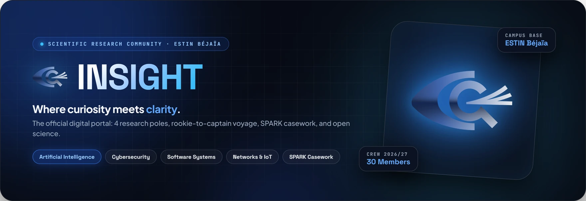
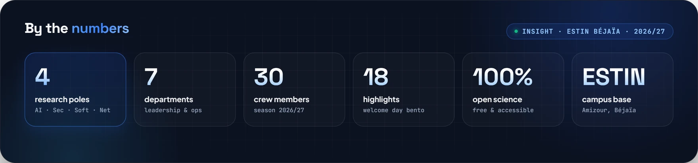
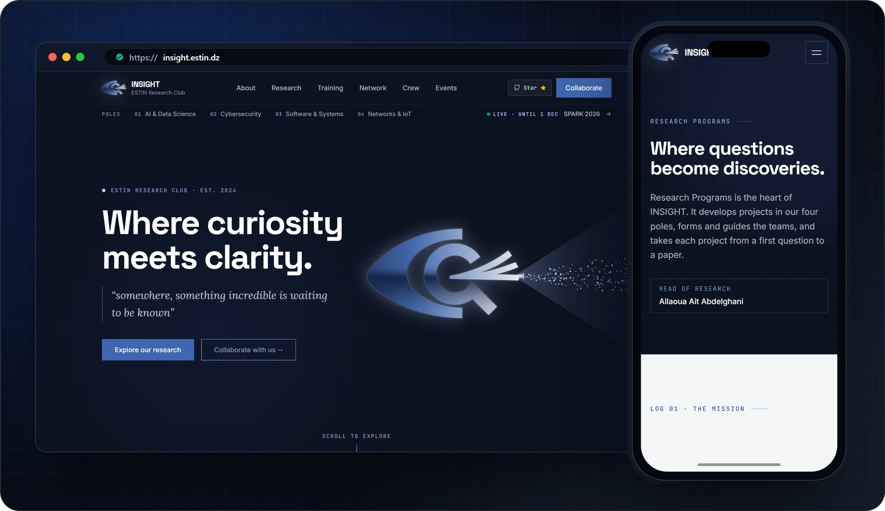
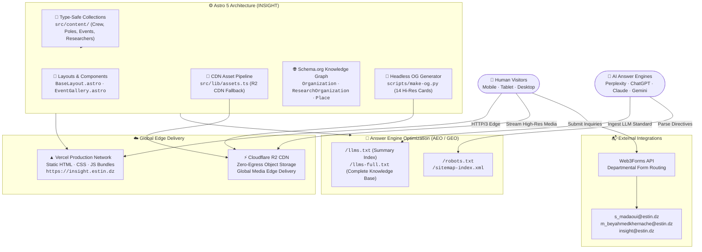

<div align="center">

<a href="https://insight.estin.dz">
  
</a>

<br><br>

# ⚓ INSIGHT Research Club
### *Where curiosity meets clarity.*

[](https://insight.estin.dz)
[](https://insight-club.vercel.app)
[](https://astro.build)
[](https://tailwindcss.com)
[](https://developers.cloudflare.com/r2/)
[](https://estin.dz)
[](https://www.instagram.com/insight.estin/)
[](https://www.linkedin.com/company/insight0)

<br>

**Four Research Poles · Rookie-to-Captain Voyage · SPARK Casework · Pro Bento Gallery · Global Research Network**<br>
The official digital platform of **INSIGHT**, the student-led scientific research community of **ESTIN Béjaïa**.  
Engineered for ultra-fast edge delivery, accessible academic publishing, and native Answer Engine Optimization (**AEO / GEO**).

<br>

[**Explore Live Platform**](https://insight.estin.dz) &nbsp;✦&nbsp;
[**Key Pillars**](#-key-pillars--platform-features) &nbsp;✦&nbsp;
[**Architecture**](#-system-architecture) &nbsp;✦&nbsp;
[**Visual Identity**](#-visual-identity--design-tokens) &nbsp;✦&nbsp;
[**Social Previews & OG**](#-open-graph--social-preview-fleet) &nbsp;✦&nbsp;
[**SEO & AEO Engine**](#-seo-aeo--knowledge-graph) &nbsp;✦&nbsp;
[**Contributing**](CONTRIBUTING.md) &nbsp;✦&nbsp;
[**The Helm**](#-the-helm--leadership)

</div>

<br>



<br><br>

---

## ✦ Platform Overview

**INSIGHT** is the student-led scientific research club of **ESTIN** (*École Supérieure en Sciences et Technologies de l'Informatique et du Numérique*) in Amizour, Béjaïa, Algeria. Officially inaugurated on **4 November 2026** during Welcome Day, INSIGHT connects foundational undergraduate computer science education with rigorous global scientific inquiry.

> *“Somewhere, something incredible is waiting to be known.”*  
> **Motto:** Where curiosity meets clarity.

Built on **Astro 5** and **Tailwind CSS v4**, this website operates as a 100% pre-rendered static editorial hub. It incorporates a **pro-grade mathematical Bento gallery** with a fullscreen keyboard-navigated lightbox, automated zero-egress media delivery via **Cloudflare R2**, enterprise-grade **HTTP security and caching headers**, an enriched **Schema.org knowledge graph**, and native **AEO endpoints** (`/llms.txt` and `/llms-full.txt`) for generative AI search engines.

<br>

<div align="center">
  
</div>

<br>

---

## ✦ Key Pillars & Platform Features

<table>
<tr>
<td width="50%" valign="top">

### 🧭 01 · Nautical Voyage & Home
- **Maritime Scientific Narrative:** Leads students from initial curiosity to scientific publishing, outlining the Helm, live event dispatches, and active tracks.
- **Editorial Metrics Band:** Verified counters for the 4 research poles, 7 departments, 30 crew members, and scientific milestones.
- **Interactive FAQ Accordion:** Accessible accordion pre-compiled into Schema.org `FAQPage` rich results for Google search.
<br><sub>Route: <code>/</code></sub>

### 🔬 02 · Four Research Poles
- **Artificial Intelligence (AI):** Trustworthy AI, adversarial robustness, mechanistic interpretability, and LLM safety.
- **Cybersecurity:** Cryptographic foundations, secure protocol engineering, defensive systems, and vulnerability research.
- **Software Systems:** Distributed architectures, formal program verification, runtime safety, and compilers.
- **Networks & IoT:** Internet protocol resilience, edge computing, decentralized consensus, and embedded telemetry.
<br><sub>Routes: <code>/research</code> · <code>/research/ai</code> · <code>/research/security</code> · <code>/research/software</code> · <code>/research/networks</code></sub>

### 🗺️ 03 · Training: Rookie to Captain
- **Rookie (Discovery):** Reading scientific literature (arXiv, IEEE Xplore, ACM), understanding paper anatomy, citation managers (Zotero, BibTeX).
- **Explorer (Methodology):** Formulating falsifiable research hypotheses, reproducible benchmarking, statistical analysis.
- **Navigator (Academic Writing):** LaTeX typesetting (Overleaf), mathematical notation, academic structure, peer review simulations.
- **Captain (Original Research):** Leading research projects, conference & workshop manuscript authoring, mentoring recruits.
<br><sub>Route: <code>/training</code></sub>

</td>
<td width="50%" valign="top">

### ⚡ 04 · SPARK Workshop & The Music Case
- **5-Session Foundation Series:** Intensive scientific methodology workshop (*Read → Write → Connect → Apply*) concluding with a research competition.
- **The Music Case:** Interactive casework challenging teams to investigate whether background music aids or impairs reading comprehension using empirical paper triage.
- **Team & Mentor Portals:** Dedicated casework resources, step-by-step submission validation, and mentor inspection views.
<br><sub>Routes: <code>/events/spark-2026</code> · <code>/spark</code> · <code>/spark/case</code> · <code>/spark/join</code></sub>

### 📸 05 · Pro Bento Event Gallery
- **Mathematical Bento Grid:** Calibrated 270px baseline row units with 2×2 grand hero blocks and 2×1 panoramic highlight cards.
- **Precision Focal Alignment:** Custom per-photo `object-position` calibration preserving faces, stage speakers, and slide projections.
- **Interactive Lightbox Modal:** Fullscreen inspection with filmstrip navigation, keyboard shortcuts (`ESC`, Arrow keys), and mobile touch gestures.
<br><sub>Routes: <code>/events/welcome-day-2026</code> · <code>/events</code></sub>

### 🤝 06 · Strategic Collaboration Portal
- **Dual Strategic Liaison Cards:** Direct communication paths with 1-click clipboard copy, pre-filled `mailto:` links, and 48h SLA:
  - **Sara Madaoui** (*The Helm · Strategic Partnerships*): University MoUs, faculty agreements, sponsorships.
  - **Mounir Bey Ahmed Khernache** (*External Relations · Outreach*): Speaker scheduling, pole mentorship, event co-hosting.
- **Global Researcher Directory:** Profiles of visiting scientists, featuring keynote speaker **Dr. Pin-Yu Chen** (*Principal Research Scientist at IBM Research NYC*).
<br><sub>Routes: <code>/collaborate</code> · <code>/network</code> · <code>/crew</code> · <code>/contact</code></sub>

</td>
</tr>
</table>

<br>

---

## ✦ System Architecture



<br>

---

## ✦ Visual Identity & Design Tokens

INSIGHT’s aesthetic is **technical, intellectual, and nautical**: deep maritime ink backgrounds, electric cobalt blue navigational highlights, soft periwinkle borders, warm academic paper reading sections, and clean mathematical grids.

<br>

| Swatch | Token | Hex | Role & Usage |
|:---:|:---|:---:|:---|
| [](#) | `bg-ink` | `#0B1120` | Canvas background for heroes, mastheads, navigation bars, and dark surfaces |
| [](#) | `text-blue` / `bg-blue` | `#2563EB` | Cobalt royal accent: primary CTAs, active links, focal borders |
| [](#) | `text-peri-light` | `#93C5FD` | Electric periwinkle: metadata chips, filmstrip rings, glowing pill borders |
| [](#) | `bg-paper` | `#F8F9FB` | Soft academic paper canvas: longform reading, log entries, bento background |
| [](#) | `text-signal` | `#F59E0B` | Signal amber: upcoming event beacons, deadline notices, live workshop badges |
| [](#) | `text-silver` | `#E2E8F0` | High-contrast secondary typography on dark surfaces, subtle hairline dividers |

### Typography System

- **Display Headlines:** [`Space Grotesk Variable`](https://fontsource.org/fonts/space-grotesk) — Bold, geometric, modernist technical headlines.
- **Body & Longform:** [`Inter Variable`](https://fontsource.org/fonts/inter) — Industry benchmark for legibility across all screen densities.
- **Log Badges & Code:** [`JetBrains Mono Variable`](https://fontsource.org/fonts/jetbrains-mono) — Engineering-grade monospace formatting (`LOG 01 ·`, `[01 / 18]`).
- **Editorial Voice & Quotes:** [`Lora Variable`](https://fontsource.org/fonts/lora) — Classical serif italics for club philosophy and philosophical quotes.

<br>

---

## ✦ Open Graph & Social Preview Fleet

Every route in the INSIGHT platform is paired with a dedicated, high-resolution **1200×630** preview card generated programmatically via headless Chrome/Edge (`scripts/make-og.py`). Cards feature our signature deep maritime glow, nautical grid beam, and typographic badge system.

```bash
# Generate all 14 social preview cards into public/og/
npm run build:og
```

| Preview Card | Route | Dedicated Content |
|:---|:---|:---|
| `og/default.jpg` | `/` | INSIGHT Research Club · Season 2026/27 |
| `og/about.jpg` | `/about` | Club Charter, Vision & 7 Operational Departments |
| `og/research.jpg` | `/research` | Four Scientific Research Poles Overview |
| `og/research-ai.jpg` | `/research/ai` | Trustworthy AI, Adversarial Robustness & LLM Safety |
| `og/research-security.jpg` | `/research/security` | Cryptographic Foundations & Defensive Systems |
| `og/research-software.jpg` | `/research/software` | Distributed Systems & Formal Verification |
| `og/research-networks.jpg` | `/research/networks` | Computer Networks, IoT & Edge Resilience |
| `og/training.jpg` | `/training` | The Voyage from Rookie to Captain |
| `og/network.jpg` | `/network` | Visiting Scientists & Global Research Network |
| `og/crew.jpg` | `/crew` | The Helm, Departments & Pole Leads |
| `og/collaborate.jpg` | `/collaborate` | Strategic Partnerships & Institutional Liaisons |
| `og/contact.jpg` | `/contact` | Departmental Inquiries & Direct Response Desk |
| `og/events.jpg` | `/events` | Keynotes, Workshops & Scientific Competitions |
| `og/spark.jpg` | `/spark` | SPARK Research Casework & Interactive Platform |

<br>

---

## ✦ SEO, AEO & Knowledge Graph

INSIGHT implements an enterprise discovery engine designed for traditional search indexing (Google, Bing) and next-generation Answer Engine Optimization (**AEO / GEO**):

### 1. Interconnected Schema.org Graph (`@graph`)
Every page injects a rich JSON-LD graph linking organizational entities:
- **`Organization` Entity:** Complete profile with official logo, slogan, ESTIN campus GPS coordinates (`36.663647, 4.909961`), area served (`Béjaïa, Algeria`), `sameAs` social citations, and direct `parentOrganization` ([ESTIN](https://estin.dz)).
- **`ResearchOrganization` Sub-Entities:** The 4 research poles declared as distinct research sub-organizations with dedicated URLs.
- **`OrganizationRole` Leadership:** Semantic linking of Helm leadership (President, Vice-Presidents, Secretary General, External Relations).
- **`ContactPoint`:** Strategic partnership desks with email routing and direct SLA parameters.
- **`Event` Entity:** Detailed event data with free admission offers, speakers, and venue coordinates.
- **`BreadcrumbList`:** Hierarchical SERP trails for intuitive navigational snippet rendering.

### 2. Generative Engine Optimization (AEO / GEO)
- **[`/llms.txt`](public/llms.txt):** Conforms strictly to the `llmstxt.org` specification. Delivers a token-efficient, clean markdown summary indexing all primary routes, research pole syllabi, and official contacts.
- **[`/llms-full.txt`](public/llms-full.txt):** Comprehensive technical compendium containing full curriculum details, research problem statements, and academic citations (e.g., Perham & Currie 2014 DOI, Dr. Pin-Yu Chen) ready for LLM context ingestion.
- **Robots Directives:** [public/robots.txt](public/robots.txt) explicitly welcomes `GPTBot`, `ChatGPT-User`, `OAI-SearchBot`, `PerplexityBot`, `ClaudeBot`, and `Applebot-Extended`.

### 3. PWA Installability & Native Quick-Actions
- **Square Icons:** Generated square assets (`icon-192.png`, `icon-512.png`, `maskable-512.png`, and `apple-touch-icon.png`) on `#0B1120` canvas.
- **Long-Press Shortcuts:** Instant mobile shortcuts for *Research Poles*, *Training Path*, *Events Archive*, and *Collaborate* configured in [public/manifest.webmanifest](public/manifest.webmanifest).

### 4. Enterprise Security & Caching Headers ([vercel.json](vercel.json))
- **A+ Security Ratings:** `X-Content-Type-Options: nosniff`, `X-Frame-Options: SAMEORIGIN`, `Referrer-Policy: strict-origin-when-cross-origin`, and restrictive `Permissions-Policy`.
- **Edge Cache Optimization:** 1-year immutable caching for static bundles (`_astro/*`), 1-week caching for brand/OG assets, and automated revalidation for sitemaps and LLM text files.

<br>

---

## ✦ Cloudflare R2 Asset Pipeline

To maintain a lean Git repository without bloating it with gigabytes of raw event photography, media is decoupled into a high-performance **Cloudflare R2 Object Storage CDN**:

- **Zero Egress Bandwidth:** Eliminates egress bandwidth costs while streaming high-resolution photography through Cloudflare's global edge network.
- **Smart Fallback Pipeline (`src/lib/assets.ts`):**
  ```typescript
  // Resolves to Cloudflare R2 CDN automatically, with public/ local fallback
  assetUrl('/events/spark-2026/cover.webp')
  ```

### Automated R2 Sync Engine
Synchronize all local photography and generated social cards to R2:
```bash
npm run sync-r2
```
The script (`scripts/sync-r2.mjs`) scans `public/` media directories (`events`, `crew`, `researchers`, `labs`, `brand`, `og`), skips cached assets by size/hash, uploads new files, and sets immutable 1-year cache headers (`Cache-Control: public, max-age=31536000, immutable`).

> `public/crew/` and `public/events/welcome-day-2026/` are gitignored: those photos live on R2 only, so they are not stored again in every Vercel deployment. See [CONTRIBUTING.md](CONTRIBUTING.md#-engineering--architectural-standards) for how to add one.

<br>

---

## ✦ Project Structure

```text
insight-website/
├── .github/
│   └── assets/                         # High-res README showcases & optimized WebP assets
│       ├── banner.webp                 # Editorial brand banner (1760x605)
│       ├── preview.webp                # Mac browser + iPhone mockup (1760x1018)
│       ├── stats.webp                  # "By the numbers" metric card (1760x412)
│       └── src/                        # HTML stages & headless screen capture source
│
├── public/                             # Root static assets & discovery files
│   ├── brand/                          # Official logos, icons (192, 512, maskable)
│   ├── crew/                           # Verified headshots of Helm & department managers
│   ├── events/                         # Local event photo albums & posters
│   ├── labs/                           # Partner research laboratory emblems
│   ├── og/                             # 14 custom 1200x630 OpenGraph cards
│   ├── researchers/                    # Guest speaker and mentor portraits
│   ├── llms.txt                        # AI Answer Engine summary index (llmstxt.org)
│   ├── llms-full.txt                   # Deep knowledge document for LLMs / RAG ingest
│   ├── manifest.webmanifest            # Mobile PWA web app manifest & shortcuts
│   └── robots.txt                      # Crawler directives, sitemaps & AI allowances
│
├── scripts/                            # Operational & automation tooling
│   ├── make-og.py                      # Headless Chrome/Edge social card generator
│   ├── render-readme-assets.py         # Headless 2x mockup renderer (banner, stats, preview)
│   ├── sync-r2.mjs                     # Automated Cloudflare R2 asset sync engine
│   └── audit-site.py                   # Automated health, link, and JSON-LD auditor
│
├── src/
│   ├── components/                     # Modular Astro UI components
│   │   ├── cards/                      # EventRow, MemberCard, ResearcherCard
│   │   ├── home/                       # Hero, Intro, Interactive Map
│   │   ├── layout/                     # Navbar, MobileMenu, Footer
│   │   ├── sections/                   # Compass, Directions, FAQ, Masthead, SixWays
│   │   └── ui/                         # EventGallery (Bento + Lightbox), SectionHeader
│   │
│   ├── content/                        # Type-safe content collections (YAML & Markdown)
│   │   ├── crew.yaml                   # Member records, groups, roles, departments, emails
│   │   ├── departments.yaml            # The 7 operational departments
│   │   ├── events/                     # Event recaps (welcome-day-2026, spark-2026)
│   │   ├── faq.yaml                    # Frequently asked questions & structured answers
│   │   ├── partners.yaml               # Partner universities and research labs
│   │   ├── poles.yaml                  # Four research poles, topics & reading lists
│   │   └── researchers.yaml            # Scientific network directory & paper highlights
│   │
│   ├── data/                           # Global site settings & club static data
│   │   ├── club.ts                     # Slogans, stats, training tiers, voyage data
│   │   ├── contact.ts                  # Form endpoints, reply times, topic routes
│   │   └── site.ts                     # URL, email, socials, review mode, CDN base URL
│   │
│   ├── layouts/
│   │   └── BaseLayout.astro            # Master layout: Schema graph, OG tags, fonts, motion
│   │
│   ├── lib/                            # Utility helpers & pipelines
│   │   ├── assets.ts                   # Dynamic Cloudflare R2 CDN resolver + fallback
│   │   ├── content.ts                  # Query & sort helpers for content collections
│   │   └── format.ts                   # Date formats, labels, and initials
│   │
│   └── pages/                          # File-based routing (23 static routes)
│       ├── 404.astro                   # Nautical 404 page ("This island isn't on the map")
│       ├── about.astro                 # Club origins, vision, ESTIN charter
│       ├── collaborate.astro           # Strategic partnership & dual liaison portal
│       ├── contact.astro               # Smart departmental contact form
│       ├── crew.astro                  # Helm, department heads, and pole coordinators
│       ├── events/
│       │   ├── [slug].astro            # Dynamic event recap page with Bento gallery
│       │   └── index.astro             # Event schedule & chronological archive
│       ├── index.astro                 # Homepage (Hero, Log 01-08, FAQ, CTA)
│       ├── join.astro                  # Registration portal (adaptive seasonal state)
│       ├── network.astro               # Visiting researchers & academic network
│       ├── privacy.astro               # Plain-language privacy policy
│       ├── research/
│       │   ├── [pole].astro            # Specialized research pole breakdown
│       │   └── index.astro             # Four poles overview & scientific curriculum
│       ├── spark/                      # SPARK workshop casework portal
│       └── training.astro              # Rookie-to-Captain curriculum
│
├── astro.config.mjs                    # Astro configuration with @astrojs/sitemap & Tailwind
├── package.json                        # Node dependencies & automation scripts
└── vercel.json                         # Vercel rewrites, A+ security & caching headers
```

<br>

---

## ✦ The Helm & Leadership

INSIGHT is founded, governed, and maintained by the students of ESTIN:

### The Helm
- **Faci Souhaib Abdelouakil** — President
- **Sara Madaoui** — Founder · Vice President · *Strategic Partnerships & Faculty Relations* (`s_madaoui@estin.dz`)
- **Redouane Mohamed Islem** — Vice President · *Platform Lead & Digital Infrastructure* (`m_redouane@estin.dz`)
- **Feltane Anayis** — Secretary General

### Department Leadership
- **Bey Ahmed Khernache Mounir** — Head of External Relations · *Operations & Outreach* (`m_beyahmedkhernache@estin.dz`)
- **Sakhri Mohammed Firas** — Head of Training
- **Merzougui Abdellah El Ghazali** — Head of Research Programs
- **Belkerrouche Asma** — Head of Design
- **Allaoua Ait Abdelghani** — Head of Communication & Media
- **Richi Roufaida** — Head of Events & Logistics
- **Diabi Lyna** — Head of Human Resources

### Institutional Anchor
- **Host Institution:** [ESTIN](https://estin.dz/) — *École Supérieure en Sciences et Technologies de l'Informatique et du Numérique*, Amizour, Béjaïa, Algeria.

<br>

---

<div align="center">

**INSIGHT Research Club · Season 2026/27**  
*Where curiosity meets clarity.*

</div>
